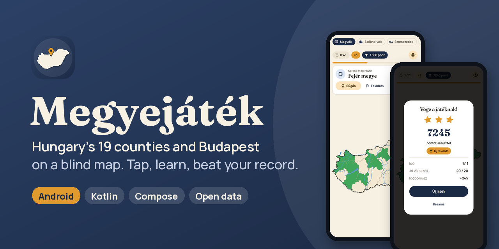
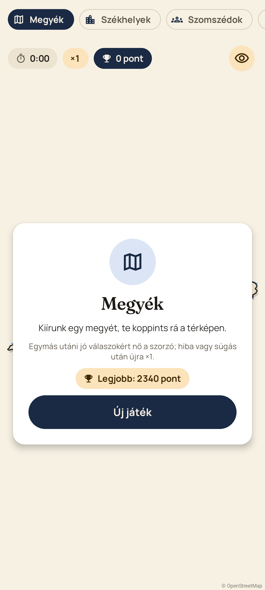
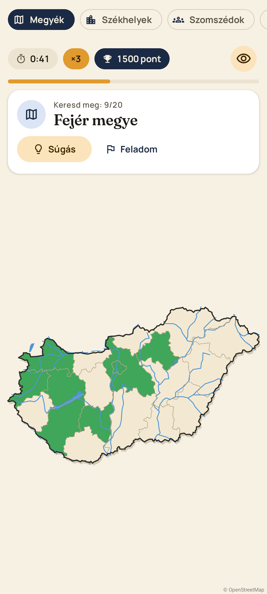
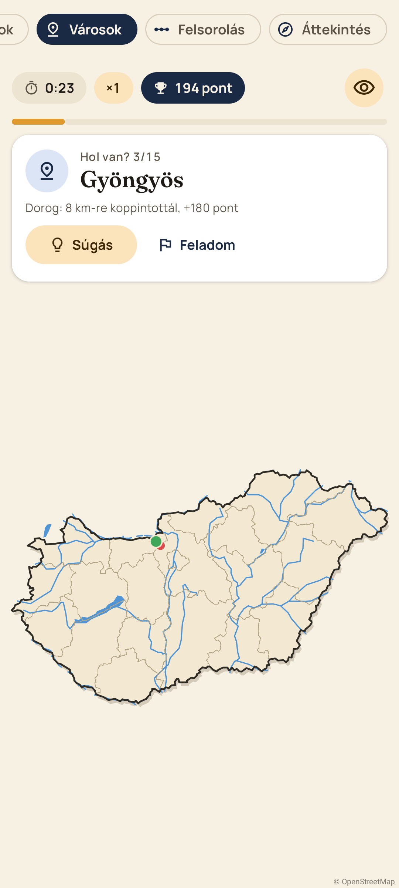
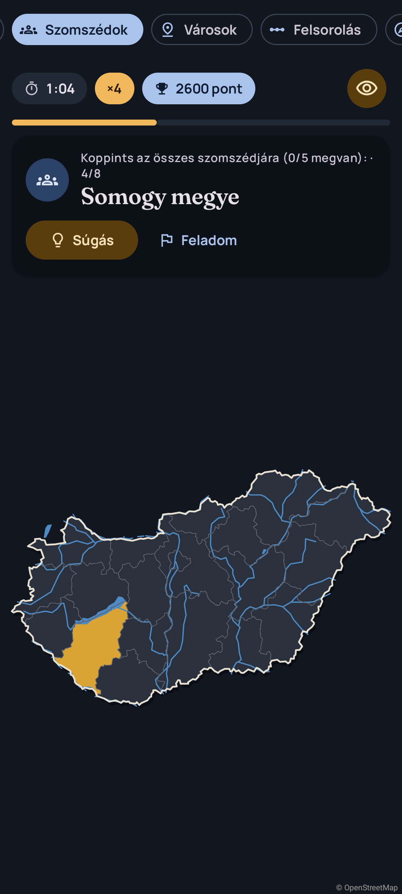
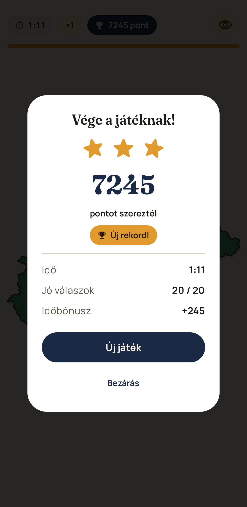
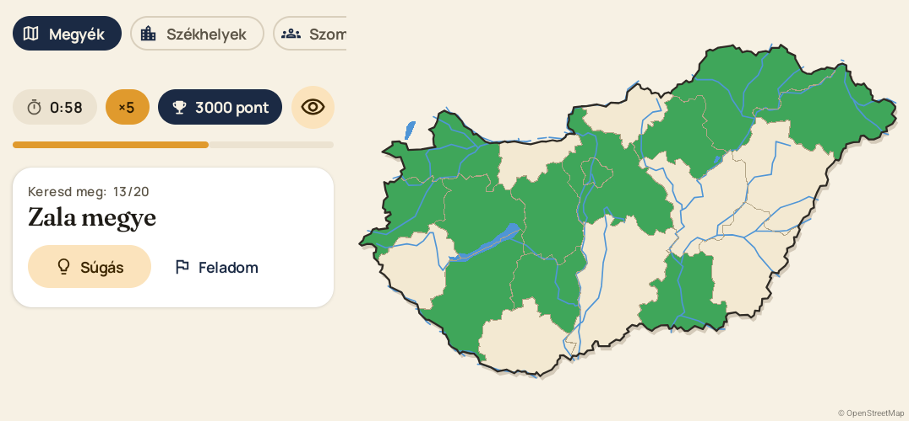

<p align="center">
  
</p>

<p align="center">
  <a href="https://github.com/valentinaschiavon99/megyejatek/releases/download/latest/megyejatek-debug.apk"></a>
  <a href="https://github.com/valentinaschiavon99/megyejatek/actions/workflows/android.yml"></a>
  <a href="https://github.com/valentinaschiavon99/megyejatek/actions/workflows/codeql.yml"></a>
  
</p>

# Megyejáték

An Android quiz about Hungary's 19 counties and Budapest: find counties, seats, neighbours and cities on a blind map. The UI is in Hungarian. *A game made by Tina.*

Written from scratch in Kotlin with Jetpack Compose. Map and city data come from open sources (see [DATA_SOURCES.md](DATA_SOURCES.md)).

<p align="center">
  
  
  
  
  
</p>
<p align="center">
  
</p>

## Features

- Five scored modes, all with a timer, a multiplier for streaks, 3 lives per game, one Súgás (hint) per game, Feladom (give up) and a time bonus:
  - **Megyék**: a county is named, tap it on the map.
  - **Székhelyek**: a county seat is named, tap its county (Pest's seat is Budapest!).
  - **Szomszédok**: a county is highlighted, tap all of its neighbours.
  - **Városok**: a town is named, tap where it is; points by distance.
  - **Felsorolás**: tap every county from west to east.
- **Áttekintés**: free study mode; tap a county to see its seat, neighbours and towns.
- Real borders from OpenStreetMap and all 139 places above 10,000 inhabitants (KSH, 1 January 2026).
- **Vaktérkép**: hide names and county borders.
- Accounts with a username and a strong password; personal records on the phone and a global leaderboard (Firebase). The game itself works offline.
- **Tanulj, mielőtt játszol**: every county with its seat, neighbours and towns; a neighbour map and table; the 139 towns by population; why it is *megye* again since October 2026; FAQ and sources.
- **Beállítások**: Vaktérkép, account (log out, delete the account and its scores), and an update check that offers the newest build from GitHub. The app also checks by itself every time it is opened.
- Plays in portrait and landscape; stars, records and a bit of confetti at the end of a round.

## Install the latest build

Every push to `main` is built by GitHub Actions. Download the debug APK on your phone and open it:
[megyejatek-debug.apk](https://github.com/valentinaschiavon99/megyejatek/releases/download/latest/megyejatek-debug.apk)
(Android asks once to allow installs from your browser.)

## Build

Requirements: Android Studio (latest stable) or JDK 17+ with the Android SDK, platform 37 installed.

```bash
./gradlew assembleDebug          # build the APK
./gradlew installDebug           # install on a connected device / emulator
./gradlew testDebugUnitTest      # unit tests
./gradlew connectedDebugAndroidTest   # Compose UI tests (device or emulator needed)
```

Or open the folder in Android Studio and press Run.

## Screenshots and icon

The screenshots above come from `ScreenshotTest`, which runs on the CI emulator and pushes its PNGs to the `screenshots` branch. The launcher icon is generated from the map outline by `tools/make_icon.py`, the banner by `tools/make_banner.py`.

## Map data

The bundled files in `app/src/main/assets/map/` are generated by `tools/build_data.py`. You only need to run it again to refresh the data. See [DATA_SOURCES.md](DATA_SOURCES.md) for how to run it.

## Tech stack

Kotlin · Jetpack Compose · Material 3 · Navigation Compose · Hilt · Room · DataStore · kotlinx.serialization · Firebase Auth, Firestore and Crashlytics. minSdk 26.

Firebase is optional at build time: without `app/google-services.json` the app builds and runs offline-only, without accounts. CI injects the file from the `GOOGLE_SERVICES_JSON_B64` secret (plain JSON or base64).

## Security

See [SECURITY.md](SECURITY.md) for how to report a vulnerability and what the app and CI do to stay safe, and [PRIVACY.md](PRIVACY.md) for what data the app stores.

## Licence

Code: MIT (see `LICENSE`). Bundled data keeps its own licences, listed in `DATA_SOURCES.md`. The fonts Fraunces and Manrope are under the SIL Open Font License (see `licenses/`).
